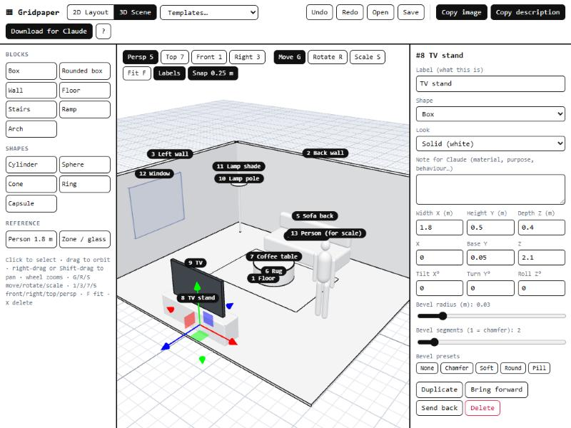
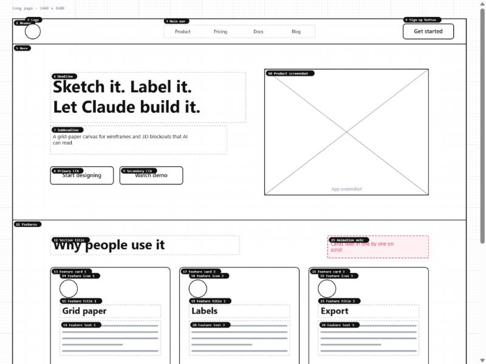
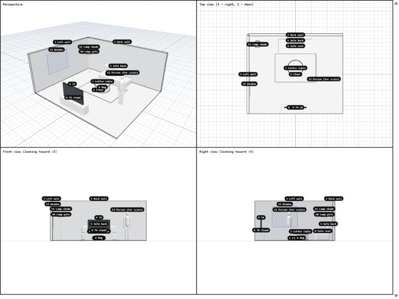

# ▦ Gridpaper

**Sketch it, label it, and let Claude build it.**

Gridpaper is a free, black-on-white, grid-paper design tool for showing an AI what you mean. Block out a **website or app layout in 2D**, or a **room, product or game level in 3D**, give every piece a clear label and a note, then export a picture plus a written description that Claude (or any AI) can follow.

You don't build anything for real here. You sketch the idea quickly, and the export explains it.

**Use it now:** https://curiocrafter.github.io/gridpaper/ (nothing to install, works in Chrome, Edge and Firefox)



## How it works

1. Pick **2D Layout** or **3D Scene** at the top. **New blank** gives you an empty canvas in that mode.
2. Start from a **template** (landing page, dashboard, mobile app, login, settings form, pricing, blog, online shop, living room, house, desk, product shot, game level) or add shapes from the left panel.
3. Click anything to give it a **label** ("Sign-up button", "Sofa") and a **note for Claude** ("opens the sign-up modal", "soft grey fabric").
4. Export:
   - **Copy image**, then paste it into Claude Code with Ctrl+V.
   - **Copy description**, then paste it in the same message.
   - Or **Download for Claude** to get both a `.png` and a `.md` file.

Then ask Claude something like *"Build this page in React and Tailwind"* or *"Make this scene in Blender with a Python script"*.

## What Claude gets

**An image** with a numbered tag on every element. A 3D scene comes out as four views (perspective, top, front, right) so the layout can't be misread:

| 2D export | 3D export |
|---|---|
|  |  |

**A description** whose numbers match the tags, with sizes, positions, nesting and your notes:

```markdown
## Elements (indented = inside the element above)
- **#1 Header** (header): 1440×80 at x 0, y 0
  - **#2 Logo** (icon / avatar): 48×48 at x 40, y 16
  - **#3 Main nav** (nav menu): 480×40 at x 480, y 20, items: "Product, Pricing, Docs, Blog"
  - **#4 Sign-up button** (button): 160×48 at x 1240, y 16, corner radius 8, text: "Get started"
```

```markdown
4. **Sofa seat** (rounded box): 2.2 × 0.45 × 0.9 m (W × H × D), base centre at x 0, y 0.05, z -1.8, rounded edges 0.08 m, sits on #1 Floor
   - Note: Soft fabric, warm grey
```

## Features

**2D layout**
- Artboards for desktop, laptop, tablet, mobile and long pages, on a 10 px grid with snapping.
- 34 wireframe elements that read clearly: header, hero, section, sidebar, card, modal, footer, divider, heading, paragraph, image, video, carousel, icon, badge, list, table, chart, map, code block, progress bar, button, link, text input, text area, dropdown, checkbox, radio button, toggle, slider, nav menu, tabs, notes and arrows.
- Red **notes** and **arrows** for behaviour and flows ("click → goes to dashboard").
- **Drawing tools**: pen, marker, highlighter, straight lines (Shift locks to 15° steps), Bézier curves with handles, and an eraser, in seven ink colours and three thicknesses. Label a mark and Claude reads it like a pen mark on a printout.
- **Smart guides**: pink lines snap edges and centres to other elements and the artboard.
- Box-select by dragging on empty space, Shift-click to add, move many things at once.
- Corner radius slider and presets (sharp, soft, round, pill), plus align-on-artboard buttons (left, centre, right, full width, top, middle).
- Scroll to pan and Ctrl+scroll or pinch to zoom (like Figma), or use the + / − buttons.

**3D scene**
- Boxes, rounded boxes, walls, floors, doors, windows, stairs, ramps, arches, cylinders, hex prisms, spheres, cones, pyramids, rings, capsules, trees, a 1.8 m person for scale, see-through zones and red **note pins**.
- **Bevel tools**: a radius slider, a segments slider (1 = chamfer) and presets (none, chamfer, soft, round, pill) on boxes, cylinders, stairs, ramps and arches.
- **Sides** slider and presets on cylinders and cones: round, octagon, hexagon, square, triangle (prisms and pyramids).
- **Drop down** sets an object onto whatever is underneath it.
- Blender-style keys: **G** move, **R** rotate, **S** scale, **1 / 3 / 7 / 5** front / right / top / perspective, **F** fit, **X** delete, **Shift+D** duplicate. Shift-click to select several.
- Solid, dark, ghost (glass / zone) and red (marker) looks, 0.25 m snapping, metres everywhere.

**Everywhere**
- **New blank** per mode, an **Elements** list to find and pick anything, **Lock** for backgrounds you don't want to grab by accident.
- **Build it with**: pick React, Flutter, Godot, Blender, Unity, three.js and more, and the description tells Claude.
- Copy, cut, paste, select all, duplicate, undo and redo, autosave in your browser, and Save / Open as a `.gridpaper.json` file you can share.

## Run it on your own computer

It's plain HTML and JavaScript with no build step. The only dependency is [three.js](https://threejs.org) 0.160, loaded from a CDN. Browsers don't run modules from `file://`, so start any small web server in the folder:

```bash
python -m http.server 8123
```

Then open http://localhost:8123.

## Files

| File | What it does |
|---|---|
| `index.html`, `style.css` | Page layout and look |
| `app.js` | Shared parts: properties panel, undo, save/open, export buttons, shortcuts |
| `d2.js` | 2D layout mode: SVG canvas, elements, templates, image and description export |
| `d3.js` | 3D scene mode: three.js scene, shapes and bevels, templates, four-view export |

Ideas and pull requests are welcome: new element types, templates and export formats are the easiest places to start.

## License

MIT
